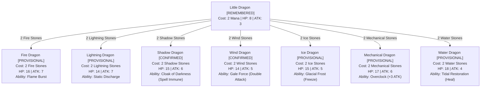

# Dragon Evolution Tree — Elemental Beast TCG

All elemental dragons stem from the common ancestor **Little Dragon** (Cost: 2 Mana).

## Evolution Rules Summary

1. Base Beast required on battlefield: `little_dragon`
2. No Mana is consumed during evolution; only matching Element Stones from the Stone Pile are deducted.
3. Evolution cures existing status ailments and refreshes maximum HP to the new dragon's printed value.
4. Evolved dragons immediately gain access to their printed activated and passive abilities.
