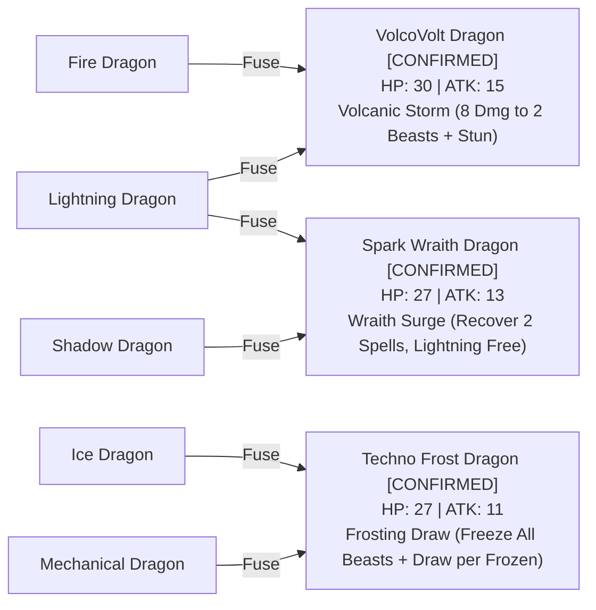

# Elemental Fusion Chart — Elemental Beast TCG

Elemental Fusion merges two compatible evolved elemental dragons present on the player's battlefield into a formidable Hybrid Fusion Dragon.

## Material Details & Abilities

### 1. VolcoVolt Dragon [CONFIRMED]
- **Required Field Materials**: `Fire Dragon` + `Lightning Dragon`
- **Stats**: 30 HP / 15 ATK
- **Ability**: `Volcanic Storm`
  - **Activation Cost**: 1 Fire Stone + 1 Lightning Stone discarded from Stone Pile.
  - **Effect**: Deals 8 damage to two different opposing creatures and inflicts `Stun`.

### 2. Spark Wraith Dragon [CONFIRMED]
- **Required Field Materials**: `Shadow Dragon` + `Lightning Dragon`
- **Stats**: 27 HP / 13 ATK
- **Ability**: `Wraith Surge`
  - **Activation Cost**: 1 Shadow Stone + 1 Lightning Stone discarded from Stone Pile.
  - **Effect**: Recovers two Spell cards from the discard pile into the player's hand. Any recovered Lightning Spells may be cast for 0 Mana during this turn.

### 3. Techno Frost Dragon [CONFIRMED]
- **Required Field Materials**: `Ice Dragon` + `Mechanical Dragon`
- **Stats**: 27 HP / 11 ATK
- **Ability**: `Frosting Draw`
  - **Activation Cost**: 1 Ice Stone + 1 Mechanical Stone discarded from Stone Pile.
  - **Effect**: Freezes all opposing Beasts on the battlefield and draws 1 card from deck for each Beast frozen.
